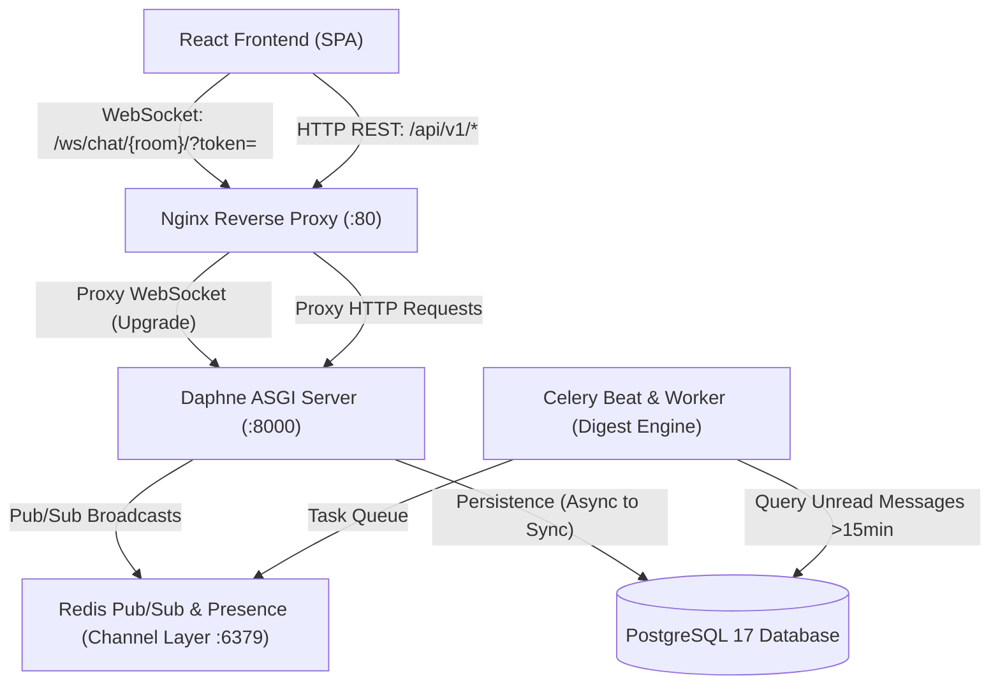

# Real-Time Chat & Notification System (`realtime-chat-channels`)

[](https://github.com/mtembez/realtime-chat-channels/actions/workflows/ci.yml)
[](https://github.com/mtembez)
[](https://python.org)
[](https://djangoproject.com)
[](LICENSE)

High-concurrency group and direct-message chat platform engineered with **Django Channels 4.x (ASGI/Daphne)** and **Redis** as the horizontal channel layer, featuring strict JWT handshake middleware, presence detection, typing indicators, soft-delete, message threading, Celery email digests, and a resilient React client with exponential back-off reconnection.

---

## 🏗️ Architecture & Data Flow



---

## ⚡ Core Technical Features

1. **Daphne ASGI & Redis Channel Layer**:
   - WebSockets run asynchronously on Daphne, routing pub/sub traffic through Redis (`channels_redis`), allowing horizontal multi-node scaling across worker processes without cross-server state sync issues.

2. **Strict Handshake JWT Authentication (`JwtAuthMiddleware`)**:
   - Connection handshake evaluates JWT tokens from URL query parameters (`?token=...`) or `Authorization: Bearer` headers.
   - **Handshake Rejection Invariant**: Unauthenticated or expired tokens are rejected *at the HTTP 101 Switching Protocols upgrade phase* with WebSocket close code `4001 (Unauthorized)`, conserving memory and socket descriptors. Non-room members are rejected with `4003 (Forbidden)`.

3. **Message Model with Soft-Delete, Threading & Receipts**:
   - `is_deleted`: Messages can be soft-deleted by sender or room admins. Content is masked (`This message was deleted.`) while preserving thread integrity.
   - `parent_message`: Self-referential foreign key powering threaded reply trees without database locking.
   - `MessageReceipt`: Per-user delivery and read tracking.

4. **Ephemeral Presence & Typing Indicators**:
   - Online/offline states tracked in Redis Hashes/Sets (`presence:room:<slug>`) with TTL cleanup.
   - Typing events debounced and broadcast to room peers (skipping the sender to eliminate self-noise).

5. **Celery Beat Unread Email Digests**:
   - Scheduled task running every 5 minutes scans for active users with unread messages older than 15 minutes.
   - Bundles messages by room and delivers formatted summary emails, marking receipts as `digest_sent=True` to guarantee idempotent single dispatch.

6. **Resilient React Frontend (`useWebSocketChat`)**:
   - Custom React hook featuring **exponential back-off reconnection with jitter** (1s base, 1.5 multiplier, 15s max).
   - **Outbound Message Queue**: Queues frames when offline and drains them atomically upon WebSocket connection restoration.

---

## 🛠️ Tech Stack

* **Backend**: Django 5.1, Django Channels 4.x, Daphne 4.x, Django REST Framework, Celery 5.x, Redis 8.x, PyJWT, Psycopg2-binary.
* **Frontend**: React 18, TypeScript, Vite, Tailwind CSS, Lucide React.
* **Database & Cache**: PostgreSQL 17, Redis 7+.
* **Infrastructure**: Docker Compose, Nginx, GitHub Actions CI.

---

## 🚀 Quickstart

### Option 1: Docker Compose (All Services)
```bash
docker compose up -d --build
```
Access the application at `http://localhost:3000` (or `http://localhost:8000` for Daphne direct).

### Option 2: Local Development

1. **Start Postgres and Redis**:
   ```bash
   podman run -d --name redis-chat -p 6379:6379 docker.io/library/redis:alpine
   ```

2. **Backend Setup**:
   ```bash
   cd backend
   python3 -m venv .venv
   source .venv/bin/activate
   pip install -r requirements.txt
   python manage.py migrate
   python manage.py runserver 8000
   ```

3. **Celery Worker & Beat**:
   ```bash
   celery -A realtime_chat worker -l info -B
   ```

4. **Frontend Setup**:
   ```bash
   cd frontend
   npm install
   npm run dev
   ```

---

## 🧪 Testing & Verification

Run the deterministic test suite:
```bash
cd backend
pytest -v
```

Build the production frontend bundle:
```bash
cd frontend
npm run build
```

---

## 👤 Author
**Simon M. Munyambu**  
GitHub: [@mtembez](https://github.com/mtembez)  
Email: [simonmaeleq7@gmail.com](mailto:simonmaeleq7@gmail.com)
