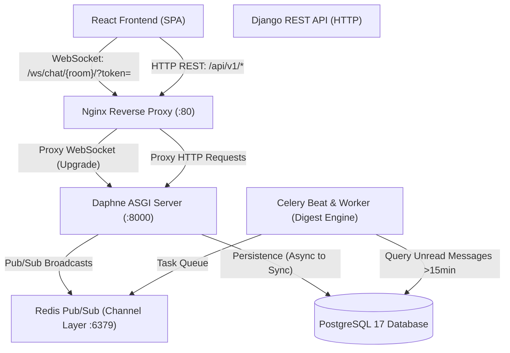

# Technical Build Specification — Real-Time Chat & Notification System (`realtime-chat-channels`)

## 0. Project Overview & Resume Grounding

Grounding in Simon M. Munyambu's resume:
> **Real-Time Chat & Notification System**
> *Django Channels · WebSockets · Redis · ASGI · React.js · PostgreSQL · JWT*
> - Built a group and direct-message chat system using Django Channels (ASGI/Daphne) with Redis as the channel layer, enabling horizontal scaling across multiple server processes.
> - Implemented presence detection (online/offline/typing indicators) as WebSocket events; secured handshakes with JWT middleware — unauthenticated connections are rejected at upgrade.
> - Designed a PostgreSQL message persistence model with soft-delete, read receipts, and threading; added Celery beat email digests for users with unread messages older than 15 minutes.
> - Built the React frontend with a custom WebSocket hook (exponential back-off reconnect), virtualized message lists, and context-managed room state.

---

## 1. System Architecture



---

## 2. Database Schema (PostgreSQL)

### 2.1 `users`
| Column | Type | Notes |
|---|---|---|
| id | UUID PK | `default=uuid.uuid4` |
| email | VARCHAR(255) | UNIQUE, indexed |
| username | VARCHAR(50) | UNIQUE, indexed |
| password_hash | VARCHAR(255) | Argon2 / PBKDF2 |
| full_name | VARCHAR(100) | |
| avatar_url | TEXT | nullable |
| is_active | BOOLEAN | default=True |
| created_at | TIMESTAMP | default=now() |

### 2.2 `rooms`
| Column | Type | Notes |
|---|---|---|
| id | UUID PK | |
| name | VARCHAR(100) | Display name for group or direct chat |
| slug | VARCHAR(120) | UNIQUE, URL-safe slug |
| is_direct | BOOLEAN | True for 1-on-1 DM, False for group channels |
| topic | TEXT | nullable |
| created_by_id | UUID FK → users.id | nullable for system channels |
| created_at | TIMESTAMP | |
| updated_at | TIMESTAMP | |

### 2.3 `room_memberships`
| Column | Type | Notes |
|---|---|---|
| id | UUID PK | |
| room_id | UUID FK → rooms.id | CASCADE |
| user_id | UUID FK → users.id | CASCADE |
| role | VARCHAR(20) | `admin`, `member` |
| last_read_message_id | UUID FK → messages.id | nullable |
| is_muted | BOOLEAN | default=False |
| joined_at | TIMESTAMP | |
| UNIQUE(room_id, user_id) | | One membership per user per room |

### 2.4 `messages`
| Column | Type | Notes |
|---|---|---|
| id | UUID PK | |
| room_id | UUID FK → rooms.id | CASCADE, indexed |
| sender_id | UUID FK → users.id | CASCADE, indexed |
| content | TEXT | Encrypted or plain UTF-8 message |
| parent_message_id | UUID FK → messages.id | nullable, self-referential for threaded replies |
| is_deleted | BOOLEAN | default=False (soft-delete flag) |
| created_at | TIMESTAMP | indexed for time-series queries |
| updated_at | TIMESTAMP | |

### 2.5 `message_receipts`
| Column | Type | Notes |
|---|---|---|
| id | UUID PK | |
| message_id | UUID FK → messages.id | CASCADE |
| user_id | UUID FK → users.id | CASCADE |
| status | VARCHAR(20) | `delivered`, `read` |
| read_at | TIMESTAMP | nullable |
| UNIQUE(message_id, user_id) | | |

---

## 3. WebSocket Handshake & Event Protocol

### 3.1 Handshake Invariant (JWT Middleware)
* Connection URL: `ws://<host>/ws/chat/<room_slug>/?token=<jwt_access_token>`
* If `token` is missing, expired, or tampered, the connection handshake is **rejected at the HTTP 101 Switching Protocols upgrade** with WebSocket close code `4001 (Unauthorized)`.
* Handshake checks that the authenticated user is an active member of `<room_slug>`. If not, rejected with close code `4003 (Forbidden)`.

### 3.2 WebSocket Frame Schema
* **Outbound Message (Client -> Server)**:
```json
{
  "action": "send_message",
  "content": "Hello team!",
  "parent_id": null
}
```
* **Broadcast Message (Server -> Clients)**:
```json
{
  "type": "chat_message",
  "id": "uuid",
  "room_slug": "general",
  "sender": {
    "id": "uuid",
    "username": "simon",
    "full_name": "Simon Munyambu"
  },
  "content": "Hello team!",
  "parent_id": null,
  "created_at": "2026-10-27T12:00:00Z"
}
```
* **Typing Indicator**:
```json
{
  "type": "typing_event",
  "username": "simon",
  "is_typing": true
}
```
* **Presence Update**:
```json
{
  "type": "presence_update",
  "user_id": "uuid",
  "username": "simon",
  "status": "online"
}
```

---

## 4. Agile Development Phases

| Phase | Title | Core Objective |
|---|---|---|
| **Phase 0** | Repo Scaffolding & CI Pipeline | Directory layout, poetry/pip requirements, GitHub Actions CI, PostgreSQL database configuration. |
| **Phase 1** | Auth, Custom User & JWT Handshake Middleware | JWT authentication REST endpoints and Channels `JwtAuthMiddleware` rejecting unauthenticated handshakes at upgrade. |
| **Phase 2** | Data Models, Rooms, Membership & Persistence | `Room`, `RoomMembership`, `Message` (soft-delete, threading), and REST endpoints. |
| **Phase 3** | Real-Time Messaging & Redis Channel Layer | `ChatConsumer` (`AsyncWebsocketConsumer`) broadcasting messages to room groups via Redis pub/sub. |
| **Phase 4** | Ephemeral Presence & Typing Indicators | Redis-backed online/offline presence tracking and broadcast typing events. |
| **Phase 5** | Read Receipts & Celery Unread Digests | Read receipts tracking and Celery beat periodic email digest task for unread messages >15 min. |
| **Phase 6** | React Frontend & Custom `useWebSocketChat` Hook | React SPA with exponential backoff reconnect hook, channel sidebar, message list, and typing indicator. |
| **Phase 7** | Production Hardening & Release Gate | Nginx reverse proxy, `docker-compose.prod.yml`, coverage ≥85%, release tag `v1.0.0`. |
